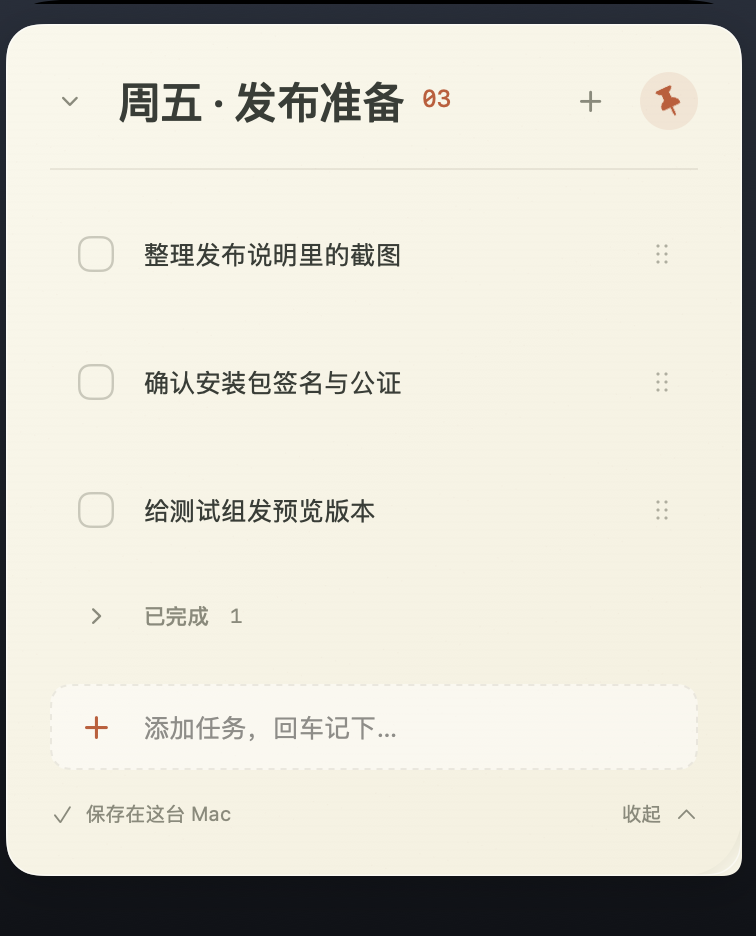
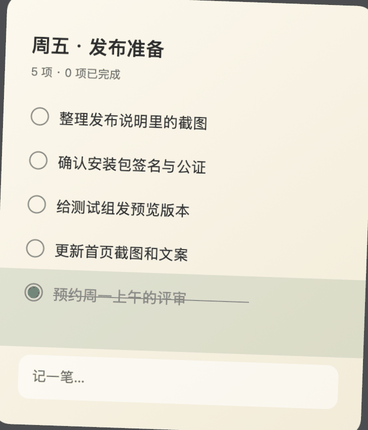

# 刘海便签 · NotchMemo

> 一张住在 MacBook 刘海里的任务便签。鼠标靠近屏幕顶部就展开，勾完最后一项，纸面揉成纸团归档。

macOS 14+（Apple Silicon）· Swift 6 · SwiftUI + AppKit + Metal · 无第三方依赖



## 它是什么

刘海便签是一个常驻菜单栏的小工具：平时完全隐藏，把鼠标移到屏幕最顶部、刘海下沿附近停留约 0.3 秒，便签就会从顶部展开。你可以直接在里面记录任务、勾选完成、拖动排序；全部勾完后，纸面会冻结成一张纸、揉成纸团，归档并自动打开下一张空白便签。

数据只保存在本机，不需要账号，也没有网络请求。

## 功能

- **靠近刘海展开**：0.3 秒停留唤出，移开后 0.6 秒自动收起；也可以固定展开。
- **一份清单**：回车添加、点击勾选、点击展开全文、右键编辑/删除，删除后 5 秒内可撤销。
- **拖动排序**：按住任务右侧的六点手柄拖动；只在手柄上生效，避免误拖。
- **完成即归档**：全部勾完后纸面冻结、网格折叠、Metal 渲染的揉纸动画，随后打开新便签。
- **菜单栏入口**：「我的便签」切换进行中的便签、查看已归档便签。
- **MacBook 细节**：不占 Dock、适配刘海热区、全屏与多个 Spaces 可唤出、睡眠/锁屏停止轮询、遵循「减少动态效果」。
- **本地存储**：原子写入，保留上一版备份；无登录、无云同步、无网络请求。

完成时的揉纸效果（参考 React Bits 的 Paper Crumple，用本地网格模拟 + Metal 重新实现）：



## 安装

1. 到 [Releases](../../releases) 下载 `NotchMemo-0.1.29.dmg`。
2. 双击打开，把「刘海便签」拖进「应用程序」文件夹。
3. 首次打开：在「应用程序」里**右键**点「刘海便签」→「打开」，在系统提示中再点一次「打开」。

本版本使用本机临时签名，没有经过 Apple 公证，所以第一次不能直接双击。如果右键菜单里没有「打开」，到「系统设置 → 隐私与安全性」点「仍要打开」；也可以在终端执行：

```sh
xattr -dr com.apple.quarantine /Applications/刘海便签.app
```

更完整的安装与使用说明见 [docs/安装与使用.md](docs/安装与使用.md)（安装包内也附带 PDF）。

## 使用

- 鼠标移到屏幕最顶部、刘海下沿附近，停留约 0.3 秒展开；移开后自动收起。
- 底部输入框输入任务，回车添加；点左侧圆圈完成，点任务文字展开全文。
- 按住任务右侧的六点手柄拖动排序。
- 顶部图钉固定展开；「收起」或 Esc 收起。
- 菜单栏「我的便签」切换/查看便签。

| 快捷键 | 作用 |
| --- | --- |
| ⌘N | 新建便签 |
| Esc | 收起便签 |
| ⌘Q | 退出刘海便签 |
| ⌘Z / ⇧⌘Z | 编辑文字时撤销 / 重做 |

## 数据与隐私

任务保存在：

```
~/Library/Application Support/NotchMemo/tasks.json
```

菜单栏 →「打开数据文件夹」可直接查看。每次保存都会保留上一版 `tasks.backup.json`；应用不包含网络代码，不会上传任何内容。

## 从源码构建

需要 macOS 14+、Xcode 与 Swift 6 工具链，无第三方包依赖。

```sh
zsh scripts/build.sh      # 生成 build/刘海便签.app
zsh scripts/test.sh       # 运行全部单元测试
zsh scripts/package-dmg.sh # 生成 dist/刘海便签-<版本>.dmg（需先有 docs/安装与使用.pdf）
```

也可以用 Xcode 打开 `Package.swift` 阅读或调试源码。

构建系统会把应用临时打包为 `build/刘海便签.app`（ad-hoc 签名）；`build/` 与 `dist/` 都不进入版本库。

## 项目结构

| 路径 | 内容 |
| --- | --- |
| `Sources/MemoCore` | 与界面无关的核心逻辑：便签/任务模型、悬停状态机、本地存储与迁移 |
| `Sources/NotchMemo` | AppKit 悬浮面板、SwiftUI 界面、原生输入框与拖动、揭纸和 Metal 揉纸 |
| `Tests` | 57 项单元测试（核心层 23、应用层 34） |
| `docs` | 产品方案、开发计划、使用说明、验证记录、安装说明与截图 |
| `scripts` | 构建、测试、图标、安装包与使用说明生成 |
| `Resources` | 应用 Info.plist |

## 已知限制

- 发布包为 Apple Silicon（arm64）构建；Intel Mac 需要自行从源码编译。
- 当前是 0.1.x 预览版，未做 Developer ID 签名与 Apple 公证；首次打开需要右键「打开」。
- 只为带刘海的 MacBook 优化；无刘海的屏幕或外接屏上，热区在屏幕顶部中央。合盖时退回主屏。
- 暂不含开机自启动、iCloud 同步、多设备同步。
- 悬停由鼠标事件驱动，另有 0.15 秒安全轮询兜底；睡眠、锁屏时会停止。
- 动画遵循系统「减少动态效果」；揉纸的 shader 在首次需要时后台预编译。

## 文档

- [安装与使用](docs/安装与使用.md)
- [产品方案](docs/产品方案.md)
- [开发计划](docs/开发计划.md)
- [使用说明](docs/使用说明.md)
- [验证记录](docs/验证记录.md)

## 许可证

[MIT](LICENSE)
